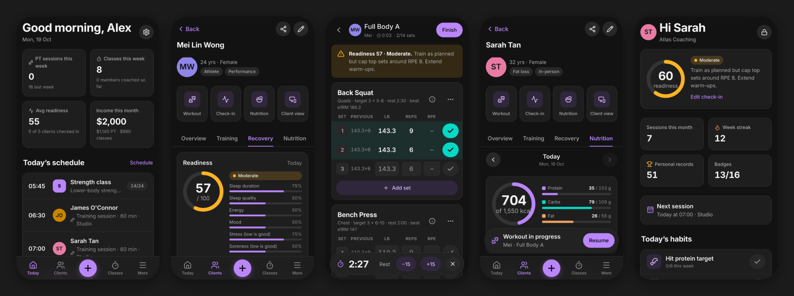
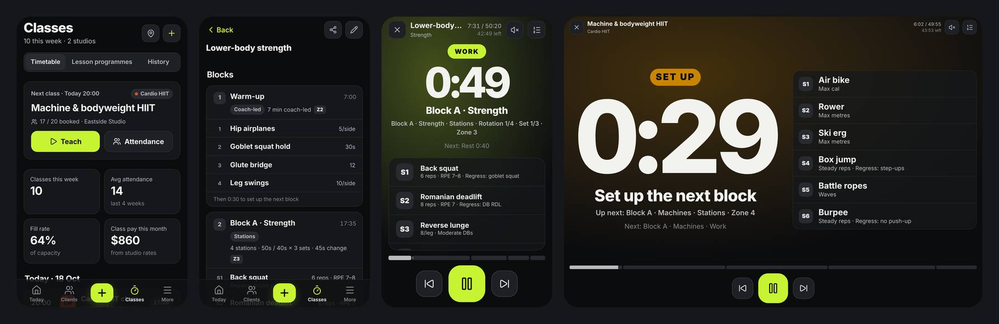

# Atlas — personal training app

Atlas is a dark-themed, mobile-first web app for personal trainers. It tracks client training, recovery and nutrition, and it includes engagement tools that keep clients coming back. It is built for iPhone and iPad. Install it to the Home Screen and it runs full screen, works offline, and keeps all data on the device.



## What's inside

| Area | Highlights |
| --- | --- |
| **Today dashboard** | Today's schedule, a "needs attention" feed (low readiness, load spikes, inactive clients, packages running out, unpaid packages, birthdays, goals at risk), a readiness board across all clients, and recent PRs. |
| **Workout logger** | Start from a template, repeat a past session or begin empty. Each set shows what the client did last time. Tap ✓ to log: blank fields fill from last time. Set types (warm-up / drop / failure), per-set RPE, live PR badges, an auto rest timer with a beep, a plate calculator, and screen wake-lock. |
| **Strength analytics** | Estimated 1RM trend per lift, weekly volume, sets per muscle against a 10 sets/week guideline, a 12-week attendance heatmap, and PR history. |
| **Recovery** | A 30-second daily check-in (sleep, energy, mood, stress, soreness with body areas, optional HRV and resting HR). It produces a 0–100 readiness score with training advice. Also: acute:chronic workload ratio (session-RPE × minutes), monotony and strain, HRV/RHR trends, and soreness hotspots. |
| **Nutrition** | Macro targets from Mifflin–St Jeor BMR × activity × goal. A food log with a ~75-item database, custom foods and quick add. Water tracker, copy previous day, and a 14-day adherence score. |
| **Body** | Weight, body fat and girth tracking with goal lines. Progress photos stored on the device, with a before/after slider. |
| **Engagement** | Goals that update automatically from logged data, weekly habits with streaks, 16 achievement badges, and a shareable Instagram-size progress card. One-tap workout summaries go to the client via WhatsApp or iMessage. **Client view** is a locked, client-friendly screen to hand over on the iPad: they do their check-in, tick habits, log food and see their progress. |
| **Group classes** | For coaches who teach studio classes (e.g. BFT): a **lesson programme library** organised by block and week. Lessons are built from blocks: stations, circuits, EMOM, AMRAP, intervals, Tabata, partner YGIG, for-time and coach-led segments, with heart-rate zones, regressions and set-up notes. A full-screen **class timer** made for an iPad on the floor or mirrored to the studio TV shows the station board, beeps 3-2-1 and can give voice cues. There is also a studio timetable, attendance check-in, post-class notes and pay per studio. Classes that PT clients attend count toward their training load. |
| **Business** | Session packages with automatic deduction, renewal and unpaid flags, revenue and sessions per month, and attendance rate. |
| **Schedule** | Week strip with day agenda, recurring weekly bookings, no-show tracking, and calendar (.ics) invites. |
| **Tools** | 1RM calculator with % table, plate calculator, Tabata/EMOM interval timer, and an RPE ↔ RIR chart. |
| **Data** | Local-first (IndexedDB). JSON backup and restore with photos, a demo studio, and kg/lb units. |



See [docs/FEATURES.md](docs/FEATURES.md) for the full feature guide and the roadmap of ideas that need a backend.

## Getting started

```bash
npm install
npm run dev        # http://localhost:5173 (also on your LAN; open it on your iPhone)
npm test           # analytics unit tests
npm run build      # production PWA in dist/
npm run preview    # serve dist/ locally
```

On first launch, choose **Explore with demo clients** to load five sample clients with months of history, or **Start fresh**.

### Use it on iPhone / iPad

1. Host the `dist/` folder over HTTPS (see *Deploying* below).
2. Open the URL in **Safari**, tap **Share → Add to Home Screen**.
3. Launch Atlas from the icon. It opens full screen and works offline.

Data is stored only in that device's browser storage, so **export a backup from Settings regularly**. Restore that backup on another device to move your data.

### Deploying

The included GitHub Actions workflow (`.github/workflows/deploy.yml`) builds and publishes to **GitHub Pages** on every push to `main`. To turn it on, go to *Settings → Pages → Build and deployment → Source: GitHub Actions*. Free GitHub accounts can only use Pages on public repositories.

`dist/` is a static site with relative paths, so any static host also works: Netlify, Vercel, Cloudflare Pages, or S3.

`npm run build:single` builds one self-contained `dist-single/index.html` without a service worker. It is handy for sharing a quick preview.

## Tech

React 19 + TypeScript + Vite, Zustand state persisted to IndexedDB (`idb-keyval`), hand-built SVG charts, `lucide-react` icons, and `vite-plugin-pwa` for the manifest and offline service worker. There is no backend and no account: everything runs on the device.

```
src/
  lib/
    types.ts            data model (kg / cm internally)
    store.ts            Zustand store + IndexedDB persistence
    analytics/          strength, recovery, nutrition, engagement, insights (+ tests)
    seed/               exercise library, food database, templates, demo data
  components/           UI kit, charts, sheets, share card, confetti
  pages/                screens (client/ holds the client profile tabs)
```

## Notes on the sports-science

- **Estimated 1RM** uses Epley (`w × (1 + reps/30)`, reps capped at 12).
- **Readiness** weights sleep duration (20%), sleep quality (15%), energy (15%), mood (10%), stress (15%) and soreness (25%). It is adjusted up to ±10 points by HRV and resting HR versus the client's own 7-day baseline.
- **Training load** follows Foster's session-RPE method. ACWR compares the 7-day load with the 28-day weekly average: 0.8–1.3 is the sweet spot and above 1.5 is a spike.
- **Nutrition targets** combine Mifflin–St Jeor BMR × activity factor with a goal adjustment (−20% / 0 / +10%). Protein is 1.8–2.2 g/kg; fat is at least 0.8 g/kg or 25% of calories.

These are coaching aids, not medical advice. The PAR-Q screen flags clients who need medical clearance.

Atlas is an independent tool and isn't affiliated with Body Fit Training (BFT) or any studio brand. The program names in the class builder are only labels, and the bundled example lessons are generic samples rather than any studio's official programming.
